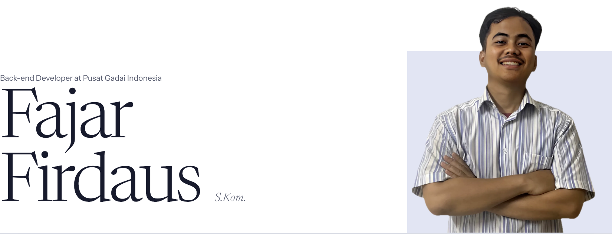

<a href="https://daussfajar.github.io/">
  <picture>
    <source media="(prefers-color-scheme: dark)" srcset="assets/header-dark.png" />
    
  </picture>
</a>

I build the internal systems organizations run on. Since 2019 I've worked across the stack at Universitas Pembangunan Jaya, Erajaya Swasembada and Pusat Gadai Indonesia, on everything from budgeting and HR to asset management and procurement.

[View my CV](https://daussfajar.github.io/) · [Download PDF](https://daussfajar.github.io/Fajar-Resume.pdf) · [LinkedIn](https://www.linkedin.com/in/daussfajar28/) · [Email](mailto:daussfajar28@gmail.com)

## Now

- **Working on:** Laravel back-end services for General Affairs systems
- **Learning:** Python, TypeScript and Go
- **Open to:** open source collaboration and freelance work
- **Happy to talk about:** API design, database modeling, authentication (JWT, PASETO) and deployment workflows

## Experience

| Role | Company | Period |
| --- | --- | --- |
| Back-end Developer | Pusat Gadai Indonesia | Apr 2025 – Present |
| GA Supervisor & Full-stack Developer | Erajaya Swasembada, Tbk | Dec 2024 – Apr 2025 |
| Full-stack Developer | Universitas Pembangunan Jaya | Oct 2019 – Dec 2024 |

## Selected work

| Project | What it does | Stack |
| --- | --- | --- |
| [Point of Sale (POS) System](https://app-staging.kamataichan.id/) | QR-code ordering for dine-in and pickup, with order tracking | Next.js |
| [E-Commerce Platform](https://m-one.online/) | Online store for M-1 tire sealants and workshop supplies | Next.js |
| Budget Disbursement System | Manages and monitors annual financial allocation | CodeIgniter, PHP, MySQL |
| Human Resource Management System | Attendance, leave requests and performance evaluation | CodeIgniter, PHP, MySQL |
| E-Office Management System | Facility booking, equipment lending and document submission | CodeIgniter, PHP, MySQL |
| Mentorship Platform | Connects mentors and mentees through profiles and session scheduling | Laravel, PHP, MySQL |

[See all 12 projects on my CV](https://daussfajar.github.io/#projects)

## Tech stack

- **Languages:** TypeScript, JavaScript, PHP, Go, Python, Dart, Java
- **Back-end:** Laravel, CodeIgniter, NestJS, Express.js, Fiber, Gin, Spring Boot
- **Front-end & mobile:** React, Next.js, Vue.js, Nuxt, Flutter, Tailwind CSS, Bootstrap
- **Data & infrastructure:** MySQL, PostgreSQL, MongoDB, Redis, SQLite, Docker, Nginx, Git

---

*Readable over clever. Simple over complete. Ship, then refine.*
